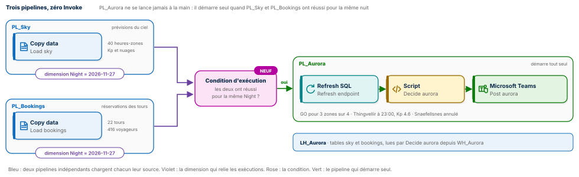
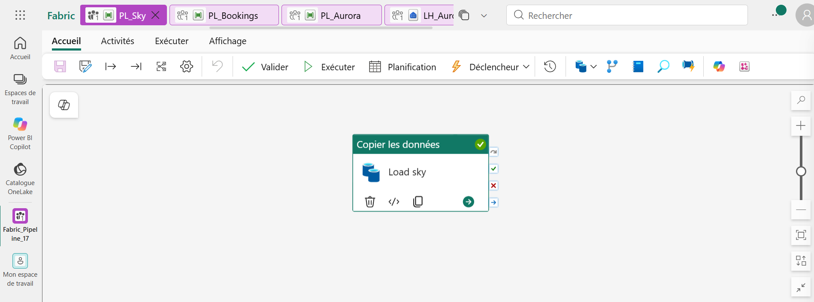
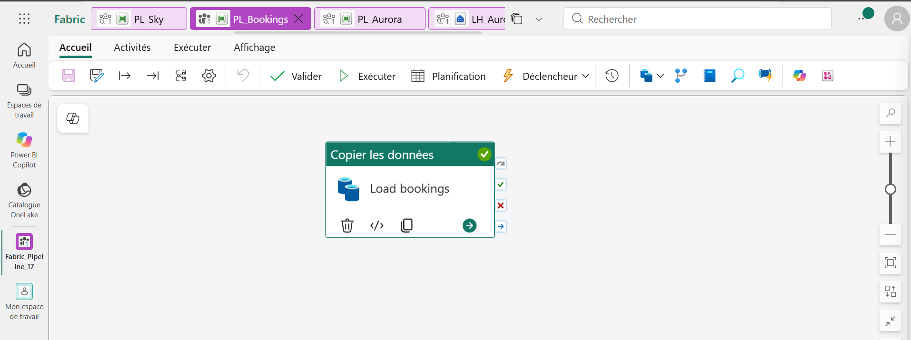
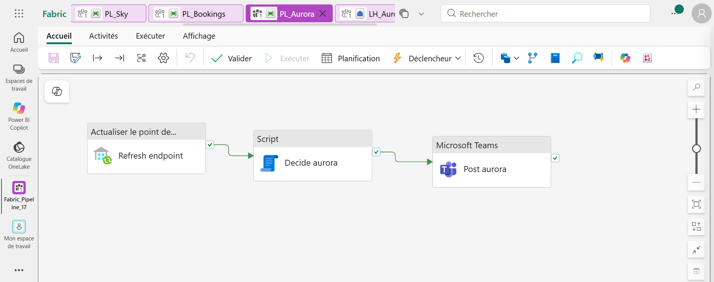
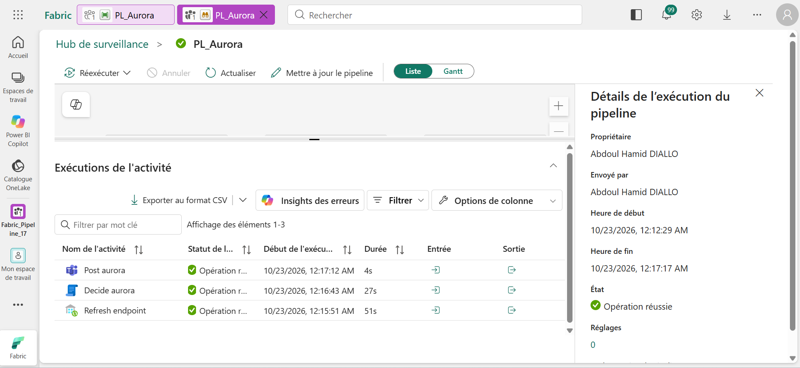
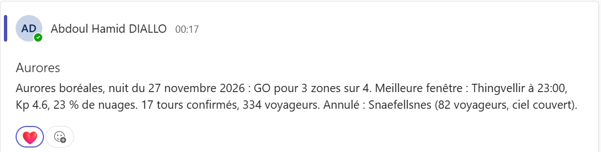
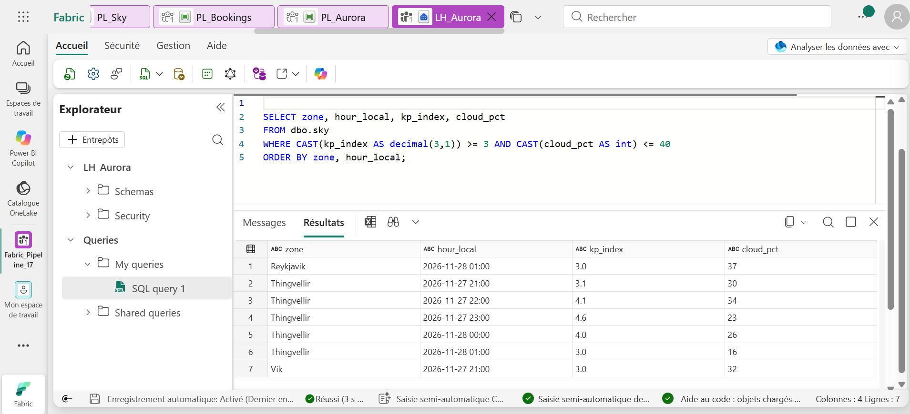
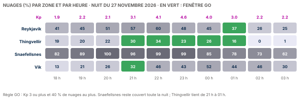

# 🌌 Fabric Pipeline Express 17 : le pipeline que personne ne lance




Trois pipelines Microsoft Fabric Data Factory qui décident, pour la nuit du 27 novembre 2026, quels tours d'aurores boréales partent en Islande. `PL_Sky` charge la prévision du ciel, `PL_Bookings` charge les réservations. Le troisième, `PL_Aurora`, **n'est jamais lancé à la main et n'est appelé par aucun Invoke pipeline** : il porte une **condition d'exécution** qui le fait démarrer tout seul quand les deux autres ont réussi pour la même **dimension d'exécution**, `Night = 2026-11-27`. Il décide alors, zone par zone, GO ou annulation, et prévient l'équipe dans Teams.

**Guide PDF de 7 pages inclus** : [`Pipeline_Fabric_Guide_17_public.pdf`](Pipeline_Fabric_Guide_17_public.pdf). Chaque écran, chaque réglage, chaque expression, et les chiffres à retrouver à l'unité près. Les valeurs à copier sont dans [`data/expressions.txt`](data/expressions.txt) et les requêtes commentées dans [`sql/`](sql).

## 📸 Aperçu

Les deux sources : deux pipelines indépendants, une seule activité chacun, la dimension `Night` posée sur leur exécution.

| PL_Sky | PL_Bookings |
|---|---|
|  |  |

Le décideur `PL_Aurora` : rafraîchir le point de terminaison, décider en SQL, annoncer.



L'exécution de `PL_Aurora`, démarrée par sa condition et non par un clic : elle commence à 00:12:29, attend que la condition soit vérifiée, puis enchaîne ses trois activités à partir de 00:15:51.



La décision publiée dans Microsoft Teams.



La requête de contrôle sur le point de terminaison SQL du lakehouse : les sept heures GO de la nuit.



## 🎯 Résultats clés

| Indicateur | Valeur |
|---|---|
| Pipelines | 3, dont 1 qui démarre seul |
| Invoke pipeline | 0 |
| Nouveautés | Dimensions d'exécution (préversion), conditions d'exécution personnalisées (préversion), attente de plusieurs pipelines en amont, une seule décision par valeur de dimension |
| Zones | 4 : Reykjavik, Thingvellir, Snaefellsnes, Vik |
| Zones GO | 3 sur 4 |
| Meilleure fenêtre | Thingvellir à 23:00, Kp 4.6, 23 % de nuages |
| Tours confirmés | 17, pour 334 voyageurs |
| Tours annulés | 5 à Snaefellsnes, 82 voyageurs, ciel couvert toute la nuit |

## 💼 Impact métier

Une agence d'aurores boréales joue sa soirée sur une décision prise avant 18 h : faire partir des bus, ou rembourser. Cette décision dépend de deux informations qui arrivent séparément, la prévision du ciel et l'état des réservations. Ici, aucune des deux équipes n'a besoin de connaître l'autre ni d'appeler le pipeline de décision : dès que les deux données de la même nuit sont prêtes, la décision tombe dans le canal de l'équipe. Les voyageurs de Snaefellsnes sont prévenus à temps, ceux de Thingvellir savent que 23 h est la bonne heure.

## 📝 Résumé

`PL_Sky` copie le CSV du ciel dans la table `sky` du lakehouse `LH_Aurora` ; `PL_Bookings` copie les réservations dans la table `bookings`. Chacun déclare, dans l'onglet **Exécuter des dimensions**, la dimension `Night` avec la valeur `2026-11-27`. `PL_Aurora` porte, dans l'onglet **Conditions d'exécution**, une condition personnalisée : dimension `Night`, pipelines en amont `PL_Sky` et `PL_Bookings`. Quand les deux ont réussi pour la même nuit, `PL_Aurora` démarre seul : `Refresh endpoint` rend les tables visibles en SQL, `Decide aurora` calcule la meilleure fenêtre de chaque zone et la phrase `msg` sur l'entrepôt `WH_Aurora`, et `Post aurora` l'annonce dans Teams.

## 🔁 Pipeline

| Pipeline | Activité | Type | Rôle |
|---|---|---|---|
| `PL_Sky` | `Load sky` | Copy data | Le ciel heure par heure vers la table `sky`. Dimension `Night` |
| `PL_Bookings` | `Load bookings` | Copy data | Les réservations vers la table `bookings`. Dimension `Night` |
| `PL_Aurora` | `Refresh endpoint` | Refresh SQL analytics endpoint | Rend les deux tables visibles en SQL sans attente |
| `PL_Aurora` | `Decide aurora` | Script | La meilleure fenêtre par zone, GO ou annulation, et la phrase `msg` |
| `PL_Aurora` | `Post aurora` | Microsoft Teams | Publie `@{activity('Decide aurora').output.resultSets[0].rows[0].msg}` |

La condition d'exécution de `PL_Aurora` : type **Personnalisé**, nom `Sky and bookings ready`, dimension `Night`, pipelines en amont `PL_Sky` et `PL_Bookings`.

## 🧠 Les quatre idées du projet

**L'enfant déclare ce qu'il attend.** Avec Invoke pipeline, le pipeline amont doit connaître et appeler le suivant. Avec une condition d'exécution, c'est l'inverse : `PL_Aurora` déclare ses dépendances, et les pipelines amont restent simples et indépendants. Ajouter une troisième source demain ne demande de modifier que la condition.

**Une dimension relie les exécutions.** `Night = 2026-11-27` est une étiquette posée sur chaque exécution. Elle permet à Fabric de savoir que le ciel et les réservations parlent de la même nuit, et de ne déclencher la décision que lorsque les deux sont prêtes.

**Tous, pas un seul.** Avec deux pipelines en amont, la condition attend que **les deux** aient réussi pour la même valeur. Lancer `PL_Sky` seul ne déclenche rien. C'est `PL_Bookings`, en complétant la paire, qui libère `PL_Aurora`.

**Une seule décision par valeur.** Une condition n'est évaluée qu'une fois par valeur de dimension. Relancer `PL_Sky` pour la même nuit ne refait pas partir les bus : la nuit du 27 a déjà été décidée. Pour la nuit suivante, une nouvelle valeur donne une nouvelle décision.

## 🚦 Le pipeline en une image

| Étape | À l'agence | Dans Fabric |
|---|---|---|
| 1 | Le service météo envoie la prévision de la nuit | `PL_Sky`, dimension `Night` |
| 2 | Le service commercial envoie les réservations | `PL_Bookings`, dimension `Night` |
| 3 | Le chef de soirée attend d'avoir les deux dossiers | Condition d'exécution de `PL_Aurora` |
| 4 | Il choisit les zones et l'heure | `Decide aurora` |
| 5 | Les guides reçoivent la consigne | `Post aurora` dans Teams |

## 🧬 Traçabilité

```
LH_Aurora / Files / sky / sky_2026-11-27.csv              LH_Aurora / Files / bookings / bookings_2026-11-27.csv
40 heures-zones : Kp et nuages                           22 tours, 416 voyageurs
          │  PL_Sky · Load sky                                     │  PL_Bookings · Load bookings
          ▼  dimension Night = 2026-11-27                          ▼  dimension Night = 2026-11-27
LH_Aurora.dbo.sky                                         LH_Aurora.dbo.bookings
          └──────────────────────────┬─────────────────────────────┘
                                     ▼
         Condition d'exécution « Sky and bookings ready » : les deux ont réussi pour Night = 2026-11-27
                                     ▼  démarrage automatique
PL_Aurora · Refresh endpoint → Decide aurora (WH_Aurora) → Post aurora
   go_zones 3 · zones 4 · top_zone Thingvellir · 23:00 · Kp 4.6 · 23 % · go_tours 17 · go_pax 334
   cancelled Snaefellsnes · 82 voyageurs · msg
```

## 🏗️ Architecture

| Objet Fabric | Type | Rôle |
|---|---|---|
| `LH_Aurora` | Lakehouse (sans schémas) | Reçoit les deux CSV, porte les tables `sky` et `bookings` |
| `CN_Lakehouse` | Connexion Lakehouse | Compte d'organisation, utilisée par le rafraîchissement du point de terminaison |
| `WH_Aurora` | Entrepôt | Exécute `Decide aurora`, lit le lakehouse par des noms en trois parties |
| `PL_Sky`, `PL_Bookings` | Pipelines | Chargent chacun une source et portent la dimension `Night` |
| `PL_Aurora` | Pipeline | Porte la condition d'exécution, décide et annonce |

Le cœur de la décision, dans `Decide aurora` : la meilleure heure de chaque zone en une fonction de fenêtrage.

```sql
ok AS (
  SELECT *, ROW_NUMBER() OVER (PARTITION BY zone ORDER BY kp DESC, cl ASC) AS rn
  FROM s WHERE kp >= 3 AND cl <= 40          -- la règle GO
),
best AS (SELECT zone, h, kp, cl FROM ok WHERE rn = 1)   -- une ligne par zone qui part
```

Une zone absente de `best` n'a aucune heure GO : ses tours sont annulés.

## 📊 Résultat final



| Zone | Décision | Meilleure heure | Kp | Nuages | Tours | Voyageurs |
|---|---|---|---|---|---|---|
| **Thingvellir** | **GO** | **23:00** | **4.6** | **23 %** | 6 | 127 |
| Vik | GO | 21:00 | 3.0 | 32 % | 4 | 89 |
| Reykjavik | GO | 01:00 | 3.0 | 37 % | 7 | 118 |
| Snaefellsnes | Annulé | aucune | | 62 à 100 % | 5 | 82 |
| **Total GO** | | | | | **17** | **334** |

Thingvellir tient de 21 h à 01 h. Snaefellsnes reste couvert toute la nuit, même au pic d'activité de 23 h.

## 📦 Jeu de données

```
data/
├── sky/
│   └── sky_2026-11-27.csv              la prévision : 4 zones × 10 heures, indice Kp et nuages
├── bookings/
│   └── bookings_2026-11-27.csv         22 tours, 5 opérateurs, 416 voyageurs
└── expressions.txt                     toutes les valeurs du guide, prêtes à copier
```

Le ciel porte `night`, `zone`, `hour_local`, `kp_index` (activité géomagnétique) et `cloud_pct` (couverture nuageuse). Les réservations portent `night`, `tour_id`, `operator`, `zone`, `departure`, `capacity` et `booked`. Prévisions, opérateurs et réservations sont fictifs, fixés pour l'exercice et reproductibles avec [`tools/generate_data.py`](tools/generate_data.py) ; [`tools/expected_results.py`](tools/expected_results.py) recalcule la décision attendue.

## 🚀 Reproduire l'exercice

1. Créer un lakehouse `LH_Aurora` sans schémas, deux dossiers `Files/sky` et `Files/bookings`, y déposer les deux CSV. Créer un entrepôt `WH_Aurora`.
2. Créer `PL_Sky` (Copy data `Load sky` vers la table `sky`) et `PL_Bookings` (Copy data `Load bookings` vers la table `bookings`), action Remplacer. Dans chacun, onglet **Exécuter des dimensions** : `Night` = `2026-11-27`.
3. Créer `PL_Aurora` : `Refresh endpoint`, le Script `Decide aurora` avec [`sql/01_decide_aurora.sql`](sql/01_decide_aurora.sql), puis Teams `Post aurora` avec `@{activity('Decide aurora').output.resultSets[0].rows[0].msg}`.
4. Dans `PL_Aurora`, onglet **Conditions d'exécution** : type Personnalisé, dimension `Night`, pipelines en amont `PL_Sky` et `PL_Bookings`. Enregistrer, sans exécuter.
5. Exécuter `PL_Sky`, puis `PL_Bookings` : `PL_Aurora` démarre seul et publie la décision. Vérifier avec [`sql/02_controle.sql`](sql/02_controle.sql).

## 📂 Structure du dépôt

```
fabric-pipeline-express-17/
├── README.md
├── Pipeline_Fabric_Guide_17_public.pdf    le guide de 7 pages
├── data/
│   ├── sky/                               la prévision du ciel
│   ├── bookings/                          les réservations des tours
│   └── expressions.txt                    toutes les valeurs à copier
├── sql/
│   ├── 01_decide_aurora.sql               la décision par zone et le message Teams
│   └── 02_controle.sql                    les heures GO de la nuit
├── tools/
│   ├── generate_data.py                   régénère les deux CSV
│   └── expected_results.py                recalcule la décision attendue
└── images/
    ├── pipeline_diagram.svg               les trois pipelines et la condition
    ├── sky_heatmap.svg                    les nuages par zone et par heure
    ├── pl_sky.png                         PL_Sky après exécution
    ├── pl_bookings.png                    PL_Bookings après exécution
    ├── pl_aurora.png                      PL_Aurora, le décideur
    ├── aurora_run.png                     l'exécution de PL_Aurora, démarrée seule
    ├── teams_message.png                  la décision dans Teams
    └── controle_sql.png                   la requête de contrôle
```

## 🧰 Stack technique

Microsoft Fabric Data Factory · Conditions d'exécution (préversion) · Dimensions d'exécution (préversion) · Copy data · Refresh SQL analytics endpoint · Script T-SQL · ROW_NUMBER et STRING_AGG · Warehouse · Lakehouse et Delta · Microsoft Teams

## ✅ Conclusion

L'orchestration la plus robuste n'est pas toujours celle qui enchaîne : c'est parfois celle qui attend. Deux pipelines indépendants posent la même étiquette sur leur travail, et le troisième part seul quand les deux sont prêts. Aucun Invoke pipeline, aucun ordre imposé, une seule décision par nuit : GO pour Thingvellir, Vik et Reykjavik, annulation propre à Snaefellsnes.

## 💭 Dernier mot

Un bon pipeline ne se lance pas toujours. Parfois, il sait simplement quand partir.

---

Abdoul Hamid Diallo · Microsoft Data & AI Engineer · Microsoft Certified DP-600, DP-700, PL-300, AI-102, DP-100, AI-900, DP-900 · [LinkedIn](https://www.linkedin.com/in/abdoul-hamid-diallo-fabric-data-engineer/)
